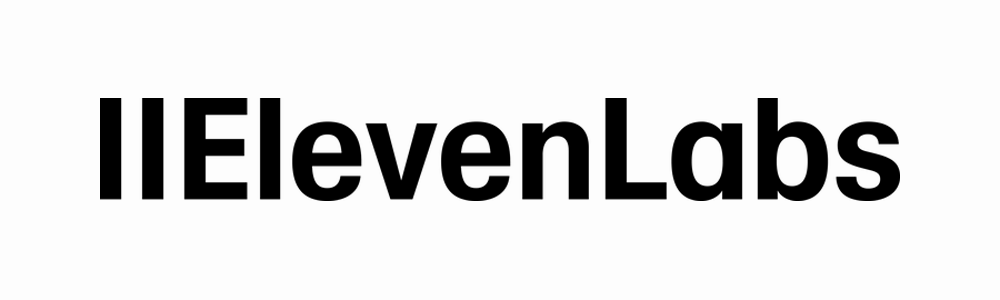
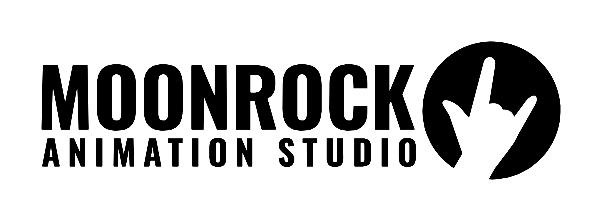

# Filmathon Kit

An open-source, tutorial-style toolkit for making a **30–90 second, fully AI-generated short film in one evening**, built for the [AI Budapest Filmathon](https://ai-budapest.com/filmathon/) (Nov 5–6, 2026), where films premiere in a cinema.

It pairs an AI coding agent (Claude Code) with ElevenLabs for generation and FFmpeg for assembly, so a team with **no editing experience** can still ship a clean, correctly formatted film.

> Not affiliated with AI Budapest or ElevenLabs. Check the [official event page](https://ai-budapest.com/filmathon/) for the rules; they win over anything here.

## The rules that shape everything

| Rule | Value |
|---|---|
| Length | **30–90 seconds** |
| Visuals | 100% AI-generated. No camera footage, no stock |
| Generation tools | Image, video, audio and music **only from the ElevenLabs Pro package** to be prize-eligible |
| File | MP4, 16:9, **24 fps**, audio in the file, 1920×1080 recommended (1280×720 minimum) |
| Name | `teamname_filmtitle.mp4` |
| Time | Theme revealed 17:30–18:00, **submission 22:30 sharp** |

**Team rule: ElevenLabs is the only generation tool we use.** No other generator and no extra credits.

## Quick start

```bash
git clone <this repo> && cd filmathon-kit
brew install ffmpeg uv            # macOS; see docs/02-setup.md for others
cp .env.example .env              # add your ELEVENLABS_API_KEY
cp .mcp.json.example .mcp.json    # lets Claude Code call ElevenLabs
cp templates/film.example.json film.json
```

Then:

1. Write the script and shot list ([docs/03-script-and-shotlist.md](docs/03-script-and-shotlist.md)).
2. Generate shots, voice, music, sfx into `shots/`, `voice/`, `music/`, `sfx/` ([docs/04-generation.md](docs/04-generation.md)).
3. Fill in `film.json` and assemble:
   ```bash
   python3 scripts/rough_cut.py film.json
   ```
4. Fix timing by editing `film.json` (or in a GUI editor, see [docs/05-editing.md](docs/05-editing.md)) and re-run. Rebuilds take seconds.
5. Validate before you submit:
   ```bash
   python3 scripts/check_delivery.py exports/teamname_filmtitle.mp4
   ```

## The evening, minute by minute

See [docs/01-timeline.md](docs/01-timeline.md). The short version: **spend 15 minutes on the idea, 2 hours generating, 1 hour editing, and keep the last 30 minutes for export and a spare.**

## Contents

| Doc | What it covers |
|---|---|
| [01-timeline.md](docs/01-timeline.md) | Time budget for the 5-hour build |
| [02-setup.md](docs/02-setup.md) | Install tools, connect ElevenLabs to Claude Code |
| [03-script-and-shotlist.md](docs/03-script-and-shotlist.md) | Writing a 60-second film that is actually makeable |
| [04-generation.md](docs/04-generation.md) | Prompting AI video, voice, music and sfx; consistency tricks |
| [05-editing.md](docs/05-editing.md) | Editing with `film.json`, or iMovie / DaVinci Resolve / CapCut |
| [06-export-and-submit.md](docs/06-export-and-submit.md) | Final export, validation, cinema checklist |

## Scripts

- `scripts/rough_cut.py`: builds the film from `film.json`. Normalises all shots to 1080p/24fps, crossfades, places voice and sfx, ducks music under the voice, normalises loudness to -16 LUFS.
- `scripts/check_delivery.py`: checks a finished MP4 against the delivery rules.

Both need only Python 3 and FFmpeg.

## Sponsors and partners

The Filmathon is organised by [AI Budapest](https://ai-budapest.com) and made possible by:

<table>
  <tr>
    <td align="center"><a href="https://elevenlabs.io"></a></td>
    <td align="center"><a href="https://ai-budapest.com/filmathon/"></a></td>
  </tr>
  <tr>
    <td align="center"><a href="https://moonrock.eu"></a></td>
    <td align="center"><a href="https://ai-budapest.com/filmathon/"></a></td>
  </tr>
</table>

- **ElevenLabs**: tools and credits for every registered team
- **TelekomFilm**: event and creative sponsor
- **Moonrock Animation Studio**: professional partner, mentors and creative guide
- **Westend Innovation Center**: venue partner for the cinema premiere

Logos are the property of their respective owners and are shown here only to credit the event's sponsors. They are **not** covered by this repository's MIT license. This kit is an independent community project and is not endorsed by the organisers or sponsors.

## License

MIT, for the code and docs. Use it, fork it, run your own filmathon.
